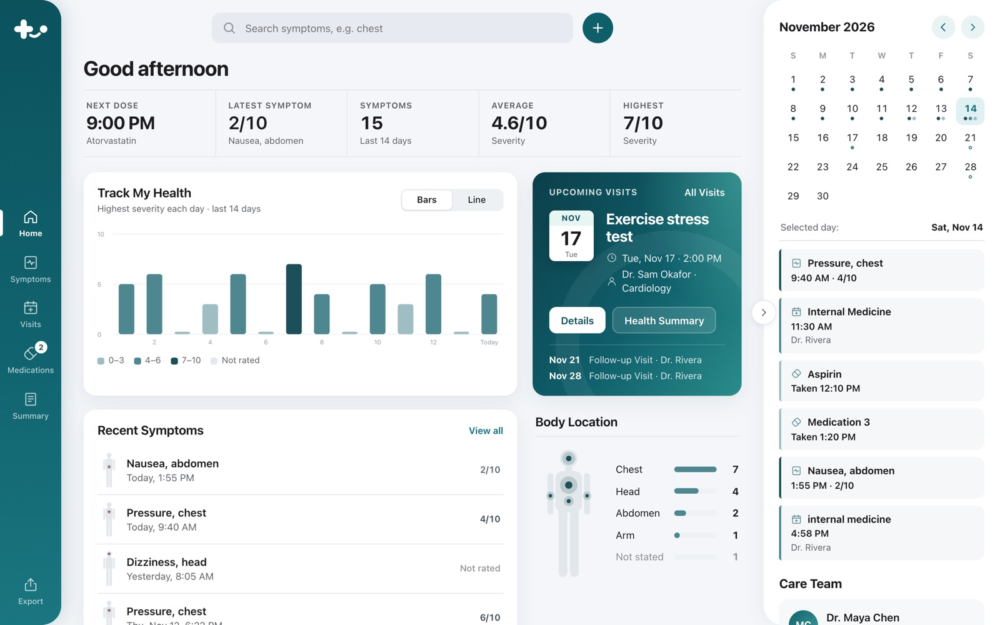
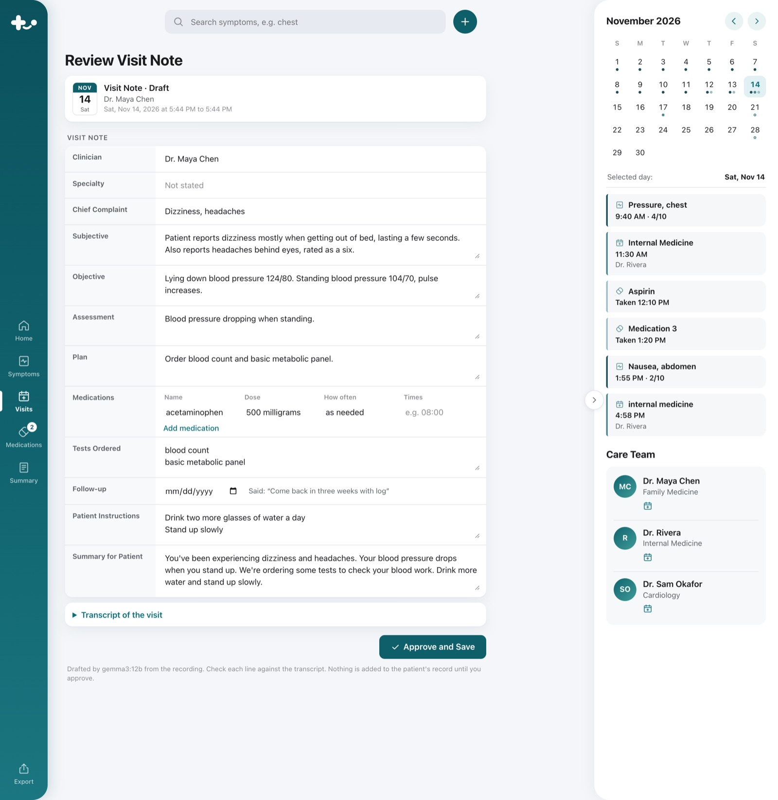
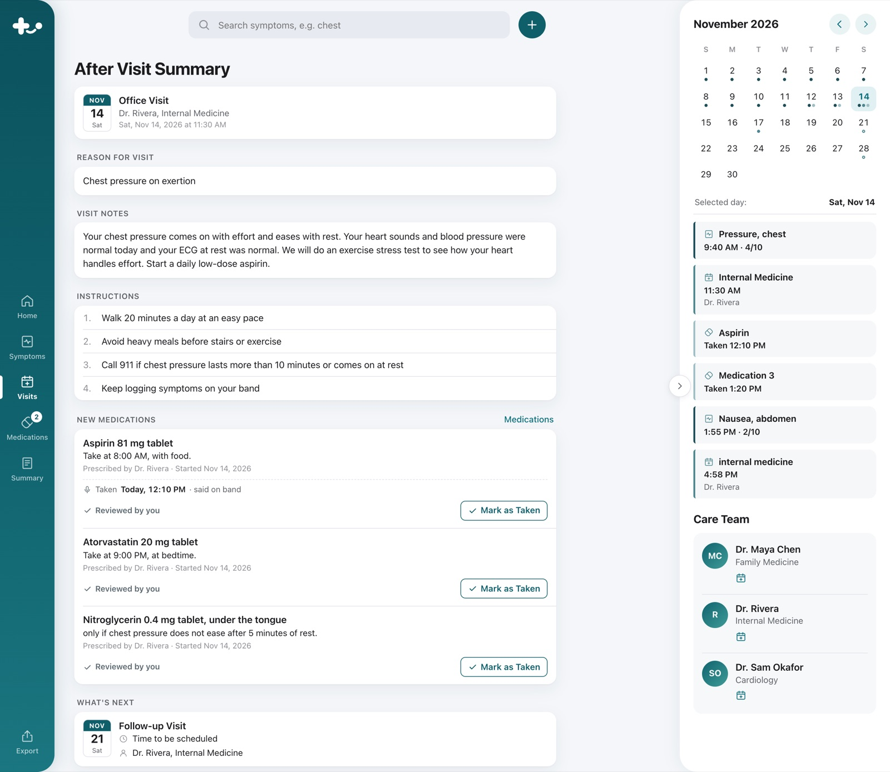
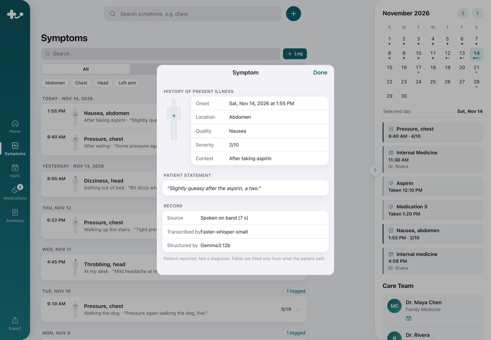
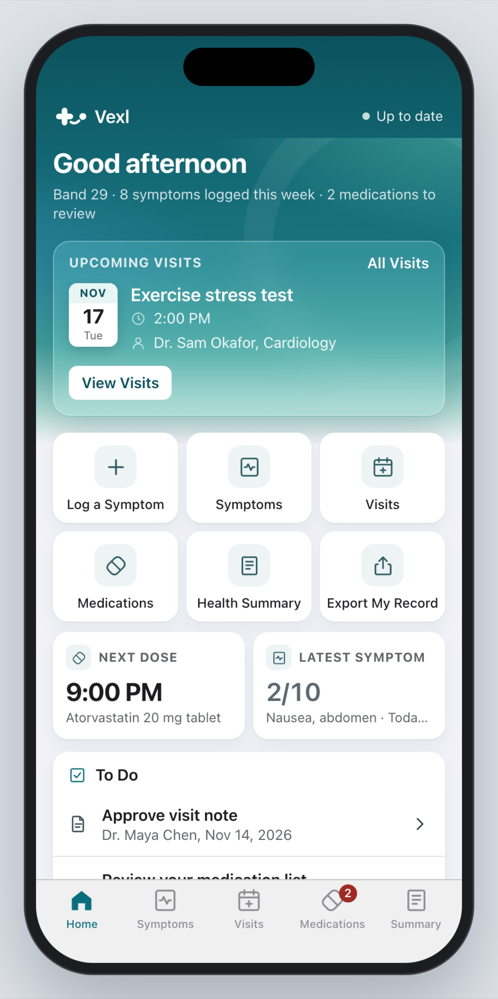

# Vexl

**A symptom log you talk to.** Say how you feel to the band on your wrist. Local models turn it into a clinical record your doctor can actually read. Nothing goes to the cloud.



## Why

When you're sick, keeping a symptom diary is a chore. You pull out your phone, type it up, and the notes end up stuck on one device in a shape no doctor can use. Then in the visit the doctor types while you talk, and an hour later you've forgotten half of what they said.

Vexl fixes both ends:

- **Between visits:** speak to the band, and get a structured timeline with onset, location, quality, severity and context.
- **In the visit:** the band records the conversation, a local model drafts the visit note, and the doctor approves it before anything is saved.

## What it does

| | |
|---|---|
| **Log by voice** | "Tight chest on the stairs, maybe a six." Whisper transcribes it on the laptop. Gemma extracts location, quality, severity and activity. If you didn't say it, the field stays empty. |
| **Built like MyChart** | Home, Symptoms, Visits, Medications, Health Summary and Export, using the words clinicians already use (chief complaint, HPI, After Visit Summary). There's a body figure for where it hurts and a 14-day severity trend. |
| **Record the visit** | Say *"I'm with the doctor"*, have the visit, then say *"the meeting is done"*. Gemma drafts a SOAP note: subjective, objective, assessment, plan, medications, tests, follow-up and a plain-language summary. |
| **Doctor approves** | The draft opens as an editable table with the transcript underneath. Nothing reaches the patient's record until the clinician clicks **Approve and Save**. |
| **Medicines** | Prescriptions from an approved visit show up as "not yet reviewed". The patient confirms them once. Doses can be logged by voice ("I took medicine one"). |
| **Private and portable** | Every record is encrypted with the device's key before it leaves the laptop, and the server only stores ciphertext. Export as FHIR (US), International Patient Summary (Europe and elsewhere) or CSV. |

| Doctor reviews the visit note | What the patient gets |
|---|---|
|  |  |

| Symptom detail | Phone |
|---|---|
|  |  |

## How it works

```
band (BLE, 16 kHz Opus)
  → local_bridge.py: decode, detect speech, faster-whisper
  → small Gemma gate: is this worth logging? symptom / dose / message / visit
  → Gemma 12B: fixed JSON schema (or a SOAP draft in visit mode)
  → sealed with AES-GCM using the device key
  → records server (VM vault: ciphertext only)
  → webapp unlocks via the local bridge and shows it
```

- **The key never leaves the machine.** `local_bridge.py` holds the device secret and hands the browser a session key, and only to allowed origins. The VM in vault mode stores opaque blobs it can't read.
- **The model never invents.** Severity is only kept if a number was said. The visit note leaves Assessment blank if the doctor never gave one. Medical codes come from a fixed table (today: LOINC pain severity), never from the model.
- **Standards at the edges.** Records use our own simple event format inside, and come out as FHIR `Observation` plus `Provenance` (which model wrote it, from which quote), `Encounter`, `MedicationRequest` and `MedicationAdministration`.

## Repo layout

```
my-project/
  local_bridge.py     device key, band pipeline, visit mode
  records_server.py   SQLite records API, FHIR/IPS/CSV export, serves the webapp
  device_crypto.py    device id, HMAC auth, AES-GCM sealing
  sync_records.py     copies sealed records local → VM vault
  deploy_records.py   deploys the records server to a Superserve sandbox
  watch.py            live demo logger (what the band heard and where it went)
  webapp/             the Vexl app: plain HTML/CSS/JS, no build step
  webapp-shell/       earlier records shell
```

## Run it locally

You need Python 3, [Ollama](https://ollama.com) with `gemma3:12b` (and `gemma3:4b` for the gate), and the Vexo Open kit in `vexo-open-kit/` for the band. The kit isn't committed.

```bash
pip install requests numpy cryptography faster-whisper sounddevice torch silero-vad superserve
ollama pull gemma3:12b && ollama pull gemma3:4b
```

Start the records server (it serves the app at `/`):

```bash
python my-project/records_server.py --port 8766
```

Start the bridge with the band, or with the laptop mic using `--mic`:

```bash
python my-project/local_bridge.py --band --records http://localhost:8766 --allow http://localhost:8766 \
  --ollama http://localhost:11434/v1 --gemma gemma3:12b \
  --ollama-fallback http://localhost:11434/v1 --gemma-fallback gemma3:4b
```

The gate always runs on the local `gemma3:4b`; `--gemma` is the extraction/visit-note model and
`--gemma-fallback` is what it falls back to if that endpoint fails. Use `--mic` instead of `--band`
to feed the laptop microphone through the same pipeline.

The band needs the Vexo Open kit on the path:
`export PYTHONPATH=$PWD/vexo-open-kit/python` (the kit is not committed).

Open http://localhost:8766. Add `?view=phone` or `?view=desktop` to force a layout.

Two more processes make the live demo complete:

```bash
# copy each sealed record to the VM vault every second (one-way, blobs only)
set -a && . ./.env && set +a && python my-project/sync_records.py --watch

# the pretty live log: what the band heard, how it was classified, what was written
python my-project/watch.py     # reads /tmp/stream.jsonl and /tmp/api.jsonl
```

### Voice commands

| Say | What happens |
|---|---|
| "My chest feels tight, about a six" | A symptom is logged |
| "I took medicine one" | A dose is logged against your first medicine |
| "I'm with the doctor" | Visit recording starts |
| "The meeting is done" | Recording stops, and a draft visit note appears for the doctor to approve |

Say commands on their own, close to the band. In a loud room a command buried in background talk can be missed.

## Limits

- This is a hackathon project, not a medical device. It doesn't diagnose, and it doesn't write into Epic or any hospital record. Getting there would mean going through Epic's patient-facing FHIR API with a registered app and a clinic that agrees to a pilot.
- Notes are drafts from local models. A clinician must review them, which is why approval is required.

## Team

Built by Shehryar and Stiven at a hackathon on the Vexo Open band, with coding agents coordinating over [Murmur](https://github.com/a-Fig/murmur).
